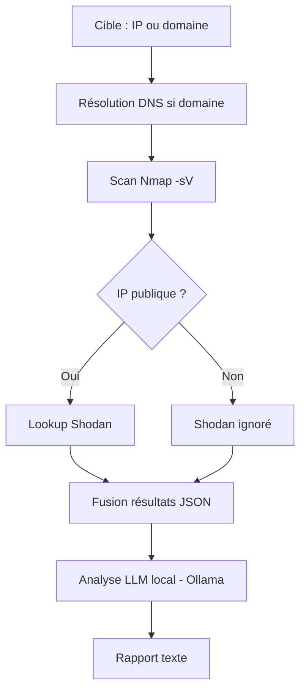

# AI-Powered Recon Tool

Automatise la reconnaissance réseau en pentest : scan Nmap, enrichissement Shodan (IP publiques), analyse par LLM local (Ollama) pour générer des pistes d'investigation.

## Stack
- Nmap (scan de ports et services)
- Shodan API (enrichissement d'IP publiques : organisation, OS, vulnérabilités connues)
- Ollama + Llama 3.2 3B (analyse IA en local, gratuit, sans clé API externe)

## Architecture du pipeline



## Preuves de fonctionnement

**Test sur scanme.nmap.org (cible publique autorisée par le projet Nmap) :**
```
[1/3] Scan Nmap sur scanme.nmap.org...
[2/3] Lookup Shodan sur scanme.nmap.org (45.33.32.156)...
[3/3] Analyse IA en cours...

Port 22 (ssh) : accès distant, risque = mot de passe faible/clé exposée
Port 80 (http) : serveur web, risque = injection de code si mal sécurisé
Port 9929 (nping-echo) : service de test, pas de risque réel identifié
```

**Enrichissement Shodan obtenu :**
```json
{
  "org": "Linode",
  "ports": [80, 31337, 123, 22],
  "vulns": ["CVE-2009-0796"]
}
```

## Utilisation
```bash
# Cible locale/privée (Shodan ignoré automatiquement)
python3 src/main.py 127.0.0.1

# Cible publique (active le lookup Shodan)
python3 src/main.py scanme.nmap.org --public
```

## Pistes d'amélioration
- Ajouter d'autres outils de scan (Nikto pour le web, subfinder pour la découverte de sous-domaines)
- Supporter le scan de plages d'IP entières (CIDR) avec parallélisation
- Croiser automatiquement les versions de services détectées avec la base CVE/NVD plutôt que de compter uniquement sur le LLM
- Générer un rapport PDF structuré plutôt qu'un simple .txt
- Ajouter une interface web légère (Flask) pour lancer des scans sans ligne de commande
- Comparer les résultats avec un modèle LLM plus gros (ex: via API) pour mesurer l'écart de qualité par rapport au modèle local 3B

## ⚠️ Usage éthique
Ne scanner que des machines que vous possédez ou pour lesquelles vous avez une autorisation explicite. `scanme.nmap.org` est un serveur mis à disposition par le projet Nmap pour les tests.

## Limites connues
- Le modèle local (3B paramètres) peut halluciner des noms d'outils ou mal interpréter certains statuts Nmap (ex: confondre "tcpwrapped" avec un vrai service, ou générer des recommandations génériques). L'outil sert à accélérer le triage initial, une validation humaine reste nécessaire.
- Shodan ne couvre que les IP publiques déjà indexées par leurs robots.

## Setup
```bash
python3 -m venv venv
source venv/bin/activate
pip install -r requirements.txt
ollama pull llama3.2:3b
```
Créer un fichier `.env` avec `SHODAN_API_KEY=votre_cle` (clé gratuite sur shodan.io).
